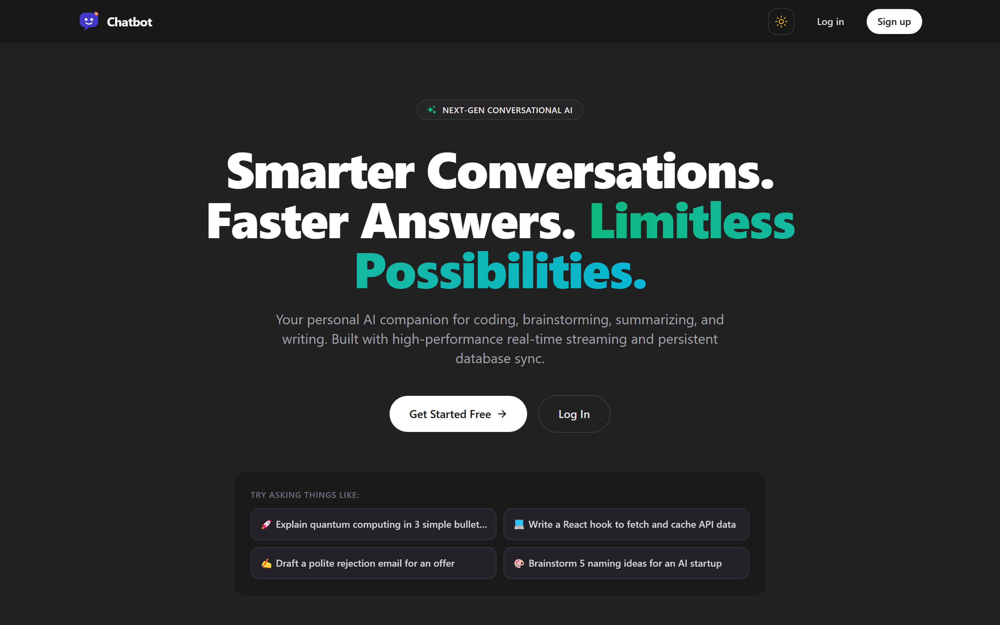
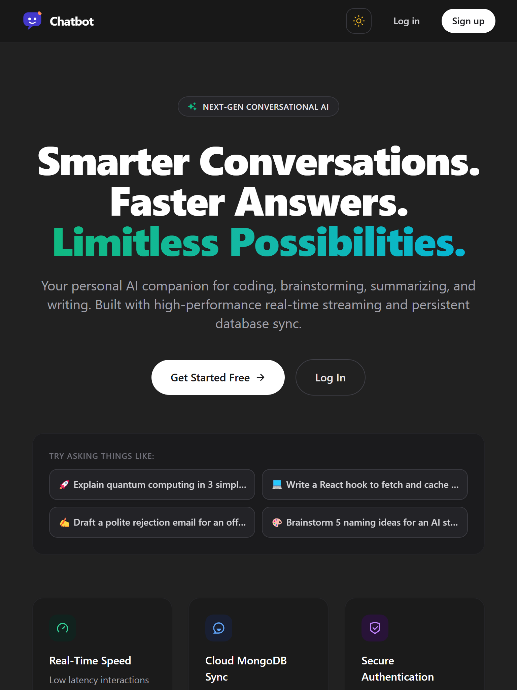
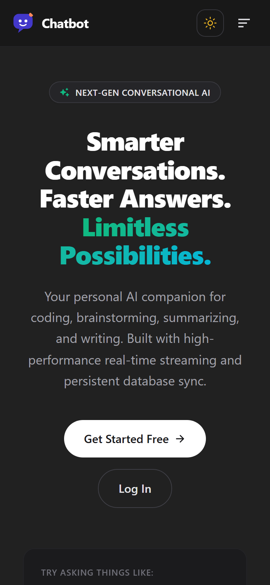
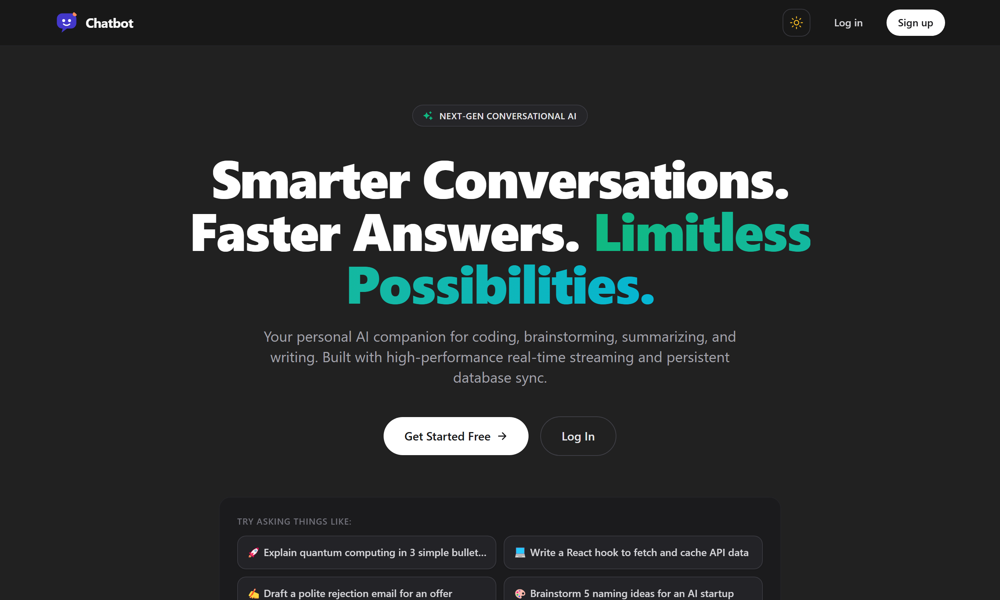
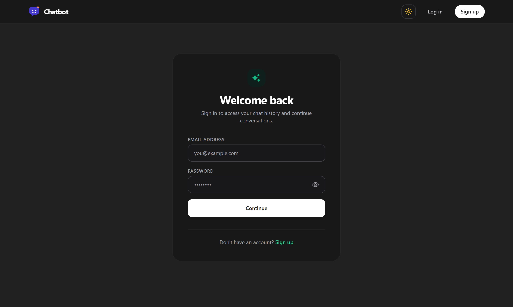
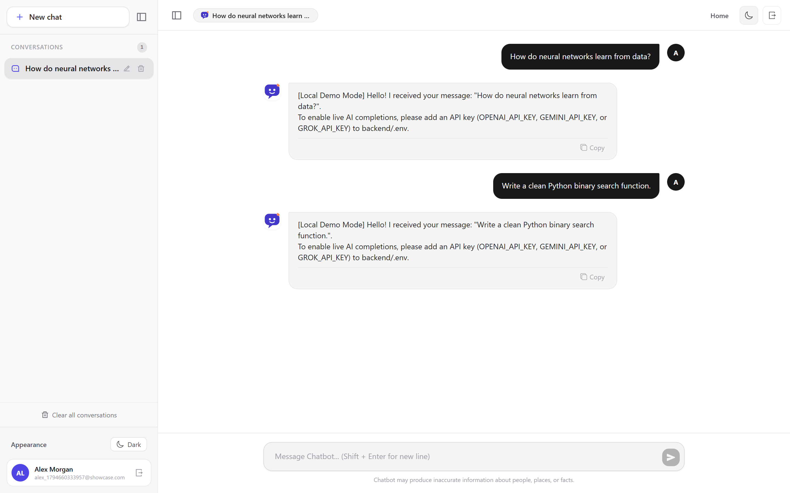

<div align="center">
  
  <h1>Chatbot — Modern Full-Stack AI Assistant</h1>
  <p><strong>A production-ready, high-performance conversational AI platform built with React, Vite, Tailwind CSS, Express, and MongoDB.</strong></p>

  <p>
    <a href="#-key-features">Key Features</a> •
    <a href="#-ui-showcase">UI Showcase</a> •
    <a href="#-tech-stack">Tech Stack</a> •
    <a href="#-quick-start">Quick Start</a> •
    <a href="#-docker-deployment">Docker</a> •
    <a href="#-api-reference">API Docs</a>
  </p>

  <p>
    
    
    
    
    
    
    
  </p>
</div>

---

## 📸 UI Showcase

### 🌟 Modern Chat Interface (Dark Mode)


<br/>

### 📱 Responsive Multi-Device UI Support

| 🖥️ Desktop (1440x900) | 📱 Tablet (768x1024) | 📱 Mobile (375x812) |
| :---: | :---: | :---: |
|  |  |  |

<br/>

### ☀️ Design & Alternate Views

| 🏠 Interactive Homepage | 🔐 Secure Authentication |
| :---: | :---: |
|  |  |

| 🌓 Light Mode Interface | 💬 Dark Mode Full Screen |
| :---: | :---: |
|  |  |

---

## ✨ Key Features

- **🗂️ ChatGPT-Style Persistent Chat History**:
  - **Multi-Session Isolation**: Automatically saves every conversation and its individual messages in MongoDB.
  - **Dynamic Sidebar**: Displays previous conversations ordered by latest activity with real-time updates.
  - **Open & Continue**: Instantly switch between conversations, retaining full conversational context and AI history.
  - **Rename Conversations**: Edit conversation titles inline with keyboard shortcuts (`Enter` to save, `Escape` to cancel).
  - **Delete Sessions**: Selectively delete individual conversations or clear entire chat history.
  - **Strict Multi-Tenant Security**: Database-level query scoping guarantees each user can access only their own conversations.
- **🌓 Dynamic Theme Toggle**: Instant, seamless Dark / Light mode switching with custom scrollbars and persistence across sessions.
- **💬 Next-Gen Chat UI**:
  - **Collapsible Sidebar**: One-click sidebar collapse/expand toggle for a distraction-free experience.
  - **Markdown & Code Rendering**: Clean formatting for code blocks, bullet points, headers, and blockquotes via `react-markdown`.
  - **One-Click Code Copy**: Copy responses with visual checkmark feedback.
  - **Auto-Expanding Input**: Floating dock textarea that grows dynamically with multi-line prompts (`Shift + Enter` for new line).
  - **Curated Prompt Starters**: Instant one-click inspiration pills for coding, brainstorming, and writing.
- **🔒 Enterprise-Grade Authentication**:
  - Secure bcrypt password hashing.
  - Signed HTTP-only session cookies with JWT verification.
  - Auth guards on private routes and automatic redirect logic.
- **🤖 Multi-Model AI Engine**:
  - **OpenAI** (`gpt-4o-mini`, `gpt-4o`, `gpt-3.5-turbo`)
  - **Google Gemini** (`gemini-1.5-flash`, `gemini-1.5-pro`)
  - **xAI Grok** (`grok-2-latest`, `grok-beta`)
  - **Zero-Setup Local Demo Fallback**: Functions out-of-the-box even without external API credentials.
- **☁️ Cloud & Local Database**: Native support for **MongoDB Atlas** clusters, alongside an automatic in-memory MongoDB fallback.
- **🐳 Production-Ready Docker**:
  - Multi-stage builds for frontend (Nginx reverse proxy) and backend (non-root `node:20-alpine`).
  - Single-origin proxy routing (`/api/`) preventing CORS issues.
  - Health checks and isolated network bridges.

---

## 🛠️ Tech Stack

| Layer | Technologies |
| :--- | :--- |
| **Frontend** | React 18, Vite 6, Tailwind CSS, React Router v7, React Icons, React Hot Toast, React Markdown |
| **Backend** | Node.js, Express 4, Mongoose 8, JWT (`jsonwebtoken`), Cookie Parser, Bcrypt, Express Validator |
| **AI Integration** | OpenAI SDK, `@google/generative-ai`, xAI API compatible |
| **Database** | MongoDB Atlas / MongoDB Memory Server |
| **DevOps** | Docker, Docker Compose, Nginx (Alpine), Multi-stage build |

---

## 📁 Repository Structure

```
chatbot/
├── backend/
│   ├── src/
│   │   ├── config/             # OpenAI & AI provider setup
│   │   ├── db_connection/      # MongoDB Atlas & in-memory connection
│   │   ├── handlers/           # Express controllers (user & chat)
│   │   ├── libs/               # JWT token utilities & validators
│   │   ├── models/             # Mongoose schemas (User & Chat)
│   │   ├── routes/             # RESTful API routing
│   │   ├── app.js              # Express app setup & CORS config
│   │   └── index.js            # Server entrypoint with graceful shutdown
│   ├── Dockerfile              # Hardened production Node container
│   ├── .dockerignore           # Container ignore rules
│   ├── .env.example            # Environment variables template
│   └── package.json
├── frontend/
│   └── chatgpt/
│       ├── src/
│       │   ├── assets/         # Vector brand assets
│       │   ├── components/     # Header, Logo, and ThemeToggle
│       │   ├── context/        # AuthContext and ThemeContext
│       │   ├── helpers/        # Axios API client functions
│       │   ├── pages/          # Homepage, Chat, Login, Signup, 404
│       │   ├── App.jsx         # App router configuration
│       │   └── main.jsx        # App root & context providers
│       ├── nginx.conf          # Nginx reverse proxy & SPA fallback
│       ├── Dockerfile          # Multi-stage production container
│       ├── .dockerignore       # Container ignore rules
│       └── package.json
├── screenshots/                # Application preview screenshots
├── docker-compose.yml          # Production container orchestration
├── docker-compose.dev.yml      # Live development with hot-reloading
└── README.md
```

---

## 🚀 Quick Start

### 1. Prerequisites
- **Node.js** v20+ and **npm**
- (Optional) **Docker Desktop**

### 2. Clone & Configure

```bash
git clone https://github.com/Segn11/chatbot.git
cd chatbot
```

Configure `backend/.env`:
```env
PORT=5000
MONGODB_URL=mongodb+srv://<username>:<password>@cluster0.vrurptw.mongodb.net/chatbot?retryWrites=true&w=majority
COOKIE_SECRET=your_super_secret_cookie_key
JWT_SECRET=your_super_secret_jwt_key

# Optional: Add your live AI model API key
OPENAI_API_KEY=
# GEMINI_API_KEY=
# GROK_API_KEY=
```

### 3. Run Locally

```bash
# Terminal 1: Backend
cd backend
npm install
npm run dev

# Terminal 2: Frontend
cd frontend/chatgpt
npm install
npm run dev
```

- Open **[http://127.0.0.1:5173](http://127.0.0.1:5173)** in your browser.

---

## 🐳 Docker Deployment

### Production Mode (Nginx Reverse Proxy)
```bash
docker compose up --build -d
```
- **Web Application**: `http://localhost` (or `http://localhost:5173`)
- **API Endpoint**: `http://localhost:5000` (and `http://localhost/api/`)

To stop:
```bash
docker compose down
```

### Development Mode (with Live Hot Reloading)
```bash
docker compose -f docker-compose.dev.yml up
```

### Offline Stack (with Local MongoDB Container)
```bash
docker compose --profile with-mongo up --build
```

---

## 📡 API Reference

| Method | Endpoint | Description | Auth Required |
| :--- | :--- | :--- | :---: |
| `POST` | `/api/v1/user/signup` | Register new user account | No |
| `POST` | `/api/v1/user/login` | Authenticate user & issue signed cookie / Bearer token | No |
| `GET` | `/api/v1/user/auth-status` | Verify session and return user profile | **Yes** |
| `GET` | `/api/v1/user/logout` | Clear cookie and terminate session | **Yes** |
| `GET` | `/api/v1/chat/conversations` | List all user conversations (ordered newest first) | **Yes** |
| `POST` | `/api/v1/chat/conversations` | Create a new conversation session | **Yes** |
| `GET` | `/api/v1/chat/conversation/:id` | Retrieve conversation details and full message history | **Yes** |
| `PUT` | `/api/v1/chat/conversation/:id` | Rename a conversation title | **Yes** |
| `DELETE` | `/api/v1/chat/conversation/:id` | Delete a specific conversation session | **Yes** |
| `POST` | `/api/v1/chat/new` | Send prompt to AI & append to conversation | **Yes** |
| `GET` | `/api/v1/chat/all-chats` | Retrieve conversation messages (active or specified) | **Yes** |
| `DELETE` | `/api/v1/chat/delete` | Clear conversation or all user history | **Yes** |
| `GET` | `/health` | Service health status check | No |

---

## 🧪 Comprehensive QA & Production Readiness

The system includes automated QA test suites covering security, AI failover, concurrency, database persistence, persistent conversation history, responsive UI, and container integrity:

```bash
# Run Phase 1 Functional & Regression Suite (31 Tests)
cd backend && node qa-test-suite.js

# Run Phase 2 Production Hardening & Concurrency Suite (13 Tests)
cd backend && node phase2-qa-suite.js

# Run ChatGPT-Style Persistent History Test Suite (11 Tests)
cd backend && node test-conversation-history.js
```

### Audit Results: 100% Pass Rate (55/55 Tests Passed)
- **ChatGPT-Style Persistent History**: Auto-created conversation sessions on first turn, seamlessly continued conversations by ID, listed sessions ordered by `updatedAt`, renamed titles inline, verified strict multi-tenant isolation (preventing cross-user reads/writes/deletions), and supported selective session deletion.
- **Security & Cryptography**: Rejected expired JWT tokens (HTTP 401), prevented NoSQL query injection attacks (HTTP 422), rejected oversized prompts (>10,000 chars), and mitigated brute-force attacks via `express-rate-limit` (HTTP 429).
- **Concurrency & Stress**: Handled 25 simultaneous user signup + AI chat transactions in parallel with 0 errors.
- **Data Persistence**: Verified multi-session durable persistence and rehydration against live MongoDB Atlas.
- **Cross-Device UI**: Validated responsive viewport adaptability across Desktop (1440x900), Tablet (768x1024), and Mobile (375x812).

---

## 📄 License

This project is licensed under the [ISC License](LICENSE).
